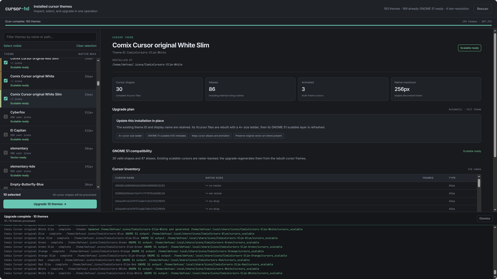
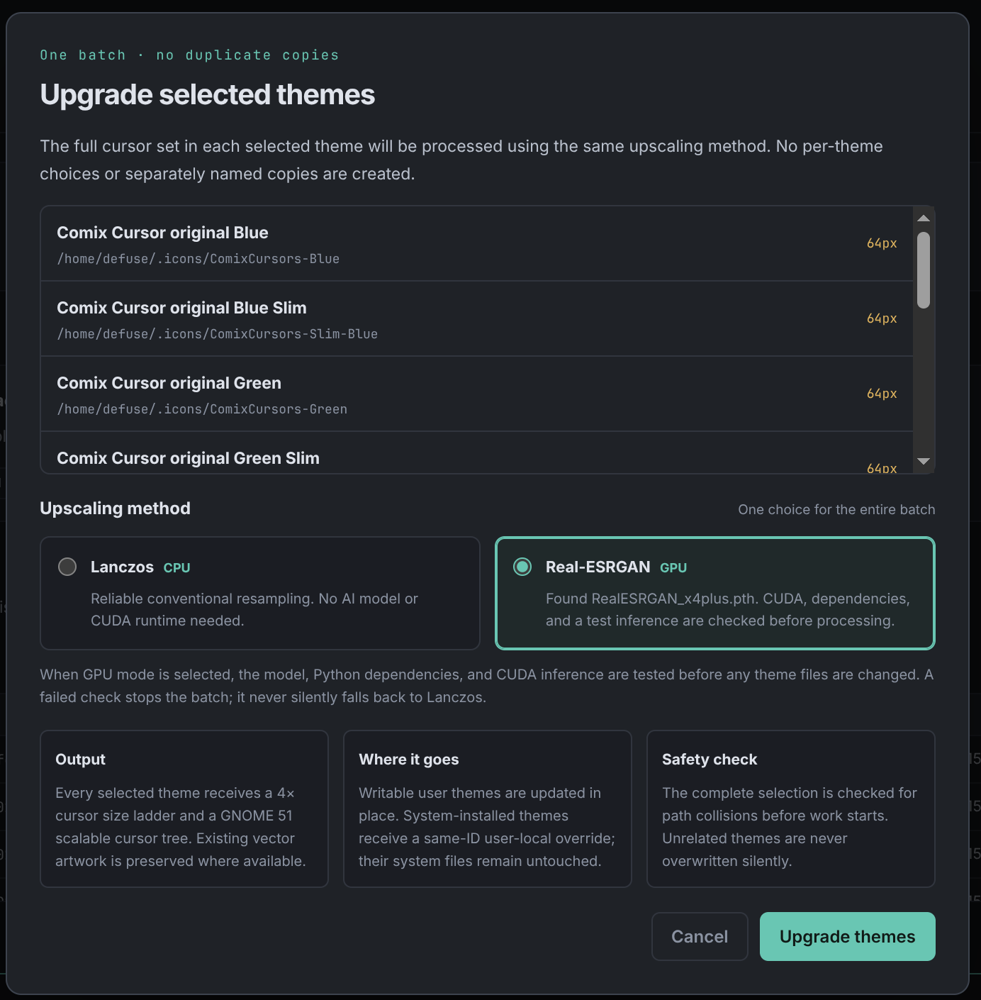

# cursor-hd

A local web application for inspecting installed Xcursor themes and upgrading selected themes to the GNOME 51 scalable-cursor layout in one batch. It supports animated cursors, preserves existing vector artwork where available, and lets you choose between Lanczos upscaling on the CPU and optional Real-ESRGAN upscaling on an NVIDIA GPU.



*Browse and filter installed themes, select multiple themes, inspect cursor inventories, and monitor upgrade progress in real time.*

> [!WARNING]
> **Back up your cursor themes before upgrading them.** Successful upgrades replace writable user themes in place, including themes under `~/.icons` and `$XDG_DATA_HOME/icons`. The application attempts to restore the original files when it detects a processing failure, but successful upgrades do not retain an automatic backup. Back up `~/.icons` and your XDG icon directory, usually `~/.local/share/icons`, before processing themes.
>
> System themes in protected directories are left unchanged. The application creates a same-ID user-local override instead.

## Features

- **Background theme scanning.** Searches `~/.icons`, `$XDG_DATA_HOME/icons`, `/usr/share/icons`, and `/usr/local/share/icons`. Reports directory, theme, and cursor-level progress while scanning and validating GNOME 51 metadata.

- **Duplicate-aware inventory.** Lists each effective theme ID once. Companion scalable themes are associated with their legacy themes, and a complete user-local override takes precedence over its system-installed counterpart.

- **Theme inspection.** Displays installation paths, theme IDs, display names, cursor counts, aliases, animations, native size ranges, and GNOME 51 compatibility. The inspection panel identifies missing or invalid scalable cursor entries.

- **Batch upgrades.** Select multiple themes and process them with one action. The application checks destination paths for conflicts before modifying any themes.

- **Selectable upscaling.** Choose Lanczos (CPU) or Real-ESRGAN (GPU) explicitly in the batch confirmation dialog. Lanczos is the default. Having a model checkpoint in `weights/` never automatically selects Real-ESRGAN.

- **Cursor reconstruction.** Extracts real Xcursor images, upscales their frames, rebuilds the size ladder with `xcursorgen`, and creates or refreshes `cursors_scalable/` with GNOME 51 metadata and aliases. Existing valid vector artwork is preserved where possible.

- **Identity preservation.** Upgrades writable user themes in place and creates same-ID overrides for protected system themes. It does not create duplicate themes with names such as `HD`, `COPY`, or `GNOME 51`.

- **Collision protection and rollback.** Refuses to overwrite unrelated themes occupying required output paths. When a processing failure is detected, the application attempts to restore the original theme files.

- **CPU fallback without rescanning.** If Real-ESRGAN fails during processing, the affected theme is restored and the batch pauses for a decision. You can explicitly continue with Lanczos on the CPU or cancel. Continuing resumes the existing batch rather than restarting the full theme scan.

## How scalable cursor generation works

The application rebuilds the legacy Xcursor size ladder and generates a GNOME 51 scalable layer from the largest cursor-size group produced by the rebuild.

When valid source vector artwork exists, the application preserves it where possible. When no source vector artwork is available, the generated SVG contains the upscaled raster frame. Although this provides a scalable-format asset, it is not vectorization and cannot reconstruct image detail absent from the original raster.

## Installation

### Requirements

- Python 3.10, recommended for compatibility with the BasicSR and Real-ESRGAN dependency stack.
- Flask and Pillow.
- PyTorch and torchvision.
- BasicSR and Real-ESRGAN.
- `xcursorgen`, which rebuilds the Xcursor size ladder.

The dependencies are declared in `requirements.txt`. You do not need a model checkpoint or a working CUDA runtime to use the default Lanczos path. Real-ESRGAN GPU processing additionally requires a compatible CUDA-enabled PyTorch installation, working NVIDIA drivers, and a supported model checkpoint.

### Recommended setup with Conda

The following creates an isolated Python 3.10 environment and installs the project dependencies:

```bash
conda create -n cursors python=3.10
conda activate cursors
python -m pip install --upgrade pip
python -m pip install -r requirements.txt
```

On Arch Linux, install the Xcursor generation utility separately:

```bash
sudo pacman -S xorg-xcursorgen
```

Other distributions should install their equivalent `xcursorgen` package.

**Note for Arch Linux users:** Avoid assuming that the distribution's system Python is compatible with every BasicSR release. Older BasicSR packaging can fail to build on Python 3.13 and newer. The Python 3.10 Conda environment is the recommended starting point for this project.

### NVIDIA GPU setup for Real-ESRGAN

For the NVIDIA CUDA 13.2 configuration used by the author, install the CUDA-specific PyTorch and torchvision wheels before the remaining project requirements:

```bash
conda create -n cursors python=3.10
conda activate cursors
python -m pip install --upgrade pip
python -m pip install torch==2.14.1+cu132 torchvision==0.29.1+cu132 --index-url https://download.pytorch.org/whl/cu132
python -m pip install -r requirements.txt
```

The exact wheel versions above are the author's configuration, not a universal recommendation for every GPU, operating system, or CUDA runtime. Consult the [official PyTorch installation instructions](https://pytorch.org/get-started/locally/) if you need a different supported combination.

Verify that the installed environment can access CUDA:

```bash
python -c "import torch, torchvision; print('PyTorch:', torch.__version__); print('torchvision:', torchvision.__version__); print('CUDA runtime:', torch.version.cuda); print('CUDA available:', torch.cuda.is_available()); print('GPU:', torch.cuda.get_device_name(0) if torch.cuda.is_available() else 'Unavailable')"
```

For Real-ESRGAN GPU processing, `CUDA available` must report `True`. If it reports `False`, check the installed PyTorch build, NVIDIA driver, and environment before selecting the GPU backend.

### Run the application

From the project root, with the intended Python environment activated:

```bash
python ./app.py
```

Open [http://127.0.0.1:5057](http://127.0.0.1:5057) in your browser.

The application runs locally and binds to `127.0.0.1`. Run it as your normal user. Root privileges are not required: protected system themes are handled through user-local overrides.

## Optional AI upscaling

### Download a checkpoint

Create the repository-root `weights/` directory and download a supported Real-ESRGAN checkpoint into it.

The recommended general-purpose model is [`RealESRGAN_x4plus.pth`](https://github.com/xinntao/Real-ESRGAN/releases/download/v0.1.0/RealESRGAN_x4plus.pth). Place the file here:

```text
cursor-hd/
└── weights/
    └── RealESRGAN_x4plus.pth
```

The application also recognizes these supported checkpoint filenames:

- `RealESRGAN_x4plus_anime_6B.pth`
- `RealESRGAN_x2plus.pth`

The application prefers `RealESRGAN_x4plus.pth` when multiple supported checkpoints are available. Model files are not bundled with the repository because of their size and are ignored by Git.

A reference SHA-256 checksum for `RealESRGAN_x4plus.pth`, listed by the linked model metadata source, is:

```text
4fa0d38905f75ac06eb49a7951b426670021be3018265fd191d2125df9d682f1
```

Verify the downloaded file with:

```bash
sha256sum weights/RealESRGAN_x4plus.pth
```

Compare the result with the reference above. The checksum reference is from [the model metadata page](https://huggingface.co/skillsafe-ai/realesrgan-x4plus/blame/main/README.md), not from the upstream Real-ESRGAN release page itself.

### Select the upscaling backend

When you click the action to process selected themes, the confirmation dialog lets you choose the backend for the entire batch.



**Lanczos (CPU)** is the default. It does not require a model checkpoint or CUDA-capable GPU.

**Real-ESRGAN (GPU)** is opt-in. The application does not switch to AI upscaling just because a supported checkpoint is present.

Before modifying any themes, GPU mode checks the selected checkpoint, imports the required runtime, validates CUDA availability, loads the model, and performs a small test inference. If this preflight fails, the batch is rejected before theme processing begins.

If Real-ESRGAN fails after processing has started, the application attempts to restore the affected theme and offers a choice to continue with Lanczos on the CPU or cancel the operation. CPU fallback is explicit. The application does not silently change backends, and choosing to continue does not trigger another full scan.

The checkpoint alone is not sufficient. Compatible versions of PyTorch, torchvision, BasicSR, Real-ESRGAN, NumPy, and OpenCV must be available in the same Python environment.

## Security and filesystem behavior

The application is intended for local use on a trusted desktop.

- The web server binds only to `127.0.0.1`.
- The API validates loopback Host and Origin values.
- Mutation endpoints require JSON content types to reject cross-site form submissions.
- The application runs with the current user's filesystem permissions.
- System themes in protected directories are not modified directly.
- Output locks prevent concurrent jobs from writing to the same theme destinations.

Do not expose the application to an untrusted network. Local binding and request checks are safeguards, not a substitute for isolating the application from hostile local processes or users.

## Tests

Run the automated tests from the project root:

```bash
PYTHONPATH=. python -m unittest discover -s tests -v
python -m py_compile *.py tests/*.py
node --check static/app.js
```

The unit and regression tests cover model discovery and selection, scalable metadata validation, vector preservation, theme-ID and companion deduplication, output collision checks, in-place user-theme upgrades, and system-theme override creation.

Additional regression coverage includes symlinked `~/.icons` directories, legacy `index.theme` encodings and section formatting, hidden temporary backup directories, malformed Xcursor table-of-contents counts, output filename suffix handling, loopback API request validation, temporary-file cleanup, cursor names containing spaces, and scan progress callbacks.

Tests use a stub `xcursorgen` executable to exercise the application pipeline without modifying the host's installed cursor themes.

### Testing limitations

The project targets Arch Linux with GNOME 51, but behavior on other distributions and desktop environments has not been verified.

The automated suite does not validate the real `xcursorgen` binary or prove that generated cursors render correctly in a live GNOME session. Real-ESRGAN processing is covered by mocked pipeline tests, not a complete GPU-and-model integration test. Successful unit tests should not be interpreted as proof that every theme will upgrade successfully or look correct in GNOME 51.

## Project structure

| File or directory | Purpose |
|---|---|
| `app.py` | Local Flask API, theme-upgrade workflow, backend selection, Real-ESRGAN preflight, CPU fallback, output locks, and progress reporting |
| `scanner.py` | Theme discovery, cursor inventory, native size and frame parsing, and GNOME 51 status |
| `upgrade.py` | Upgrade planning, destination checks, and unified theme-upgrade operation |
| `orchestrator.py` | Xcursor extraction, upscaling, rebuilding, alias preservation, theme metadata, and staged directory replacement |
| `gnome51.py` | Scalable cursor metadata and SVG generation, CSS-name aliases, vector preservation, and validation |
| `xcur_extract.py` | Xcursor parsing and image extraction |
| `xcur_upscale.py` | Lanczos and Real-ESRGAN image processing |
| `xcur_rebuild.py` | Rebuilding Xcursor files with `xcursorgen` |
| `model_utils.py` | Supported model discovery and backend-choice validation |
| `local_security.py` | Loopback Host/Origin and JSON mutation checks |
| `job_utils.py` | Safe serialization of public job status |
| `templates/index.html` | Web interface markup |
| `static/app.js` | Theme selection, confirmation dialog, API calls, and live progress updates |
| `static/style.css` | Application styling |
| `weights/` | Optional local Real-ESRGAN model checkpoints |

## License

This project is licensed under the MIT License. See [`LICENSE`](LICENSE).
